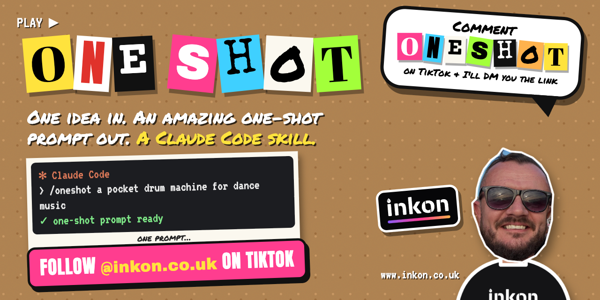

[](https://www.tiktok.com/@inkon.co.uk)

# /oneshot

**A Claude Code skill that turns a rough one-line idea into an amazing one-shot build prompt.**

Most builds take four or five prompts. The first gets something working, and the rest are predictable follow-ups:
- "add a reset",
- "give me presets",
- "make it work on my phone",
- "make it feel finished".

`/oneshot` writes all of that into the **first** prompt, so the first build is the finished build.

By [Inkon](https://www.inkon.co.uk). See the builds at [oneshot.inkon.co.uk](https://oneshot.inkon.co.uk), and follow **[@inkon.co.uk on TikTok](https://www.tiktok.com/@inkon.co.uk)** for a new one shot. Comment **ONESHOT** and I'll DM you the link.

## What's in here

| File | What it is |
|---|---|
| `SKILL.md` | The skill itself. |
| `checklist.md` | Everything a one-shot prompt must cover, plus the polish standard and a "Lessons" list that grows. |
| `prompt-template.md` | The shape of the finished prompt. |
| `banner.png` | The image at the top of this page. |
| `examples/001-pkt8-drum-machine.md` | The first ever One Shot, a browser drum machine, written as the prompt that builds it in one go. |

## Install

Clone this repo into your Claude Code skills folder:

```bash
git clone https://github.com/inkon-ltd/inkon-oneshot.git ~/.claude/skills/oneshot
```

That's it. Claude Code picks it up the next time you start a session.

## Use it

1. In Claude Code, type `/oneshot` and your idea in one line:

   ```
   /oneshot a pocket drum machine I can make dance music on
   ```

   A photo or link of whatever inspired you helps.
2. Answer up to three quick questions, if it asks any. Usually it doesn't.
3. You get a complete, paste-ready prompt, saved as `oneshot-prompts/001-<name>.md` in your project.
4. Either paste it into a **fresh** Claude Code session, or just say **"build it"**.

**Tips:**
- **Name the workflow, not just the thing.** "A drum machine *I can make dance music on*" beats "a drum machine".
- **Read the Assumptions section** before you build. That's where the skill made calls for you.
- **Did you still need a follow-up prompt after building?** Add a general line to the "Lessons" list at the bottom of `checklist.md`. Every prompt after that includes it.

## See an example

Open [`examples/001-pkt8-drum-machine.md`](examples/001-pkt8-drum-machine.md). It's the first One Shot, which originally took four prompts, rewritten as one. Play the result at [oneshot.inkon.co.uk/pkt-8](https://oneshot.inkon.co.uk/pkt-8/).

## Remix it

This is open source and remixable under [**CC BY 4.0**](LICENSE). You can use it, change it, build on it and use it commercially. If you share it or a remix of it, credit:

> /oneshot by Inkon: https://www.inkon.co.uk

Anything you **build** with the skill is yours, with no credit needed.

---

Made by John at [Inkon](https://www.inkon.co.uk). By day I make websites that bring businesses customers. Check them out.
